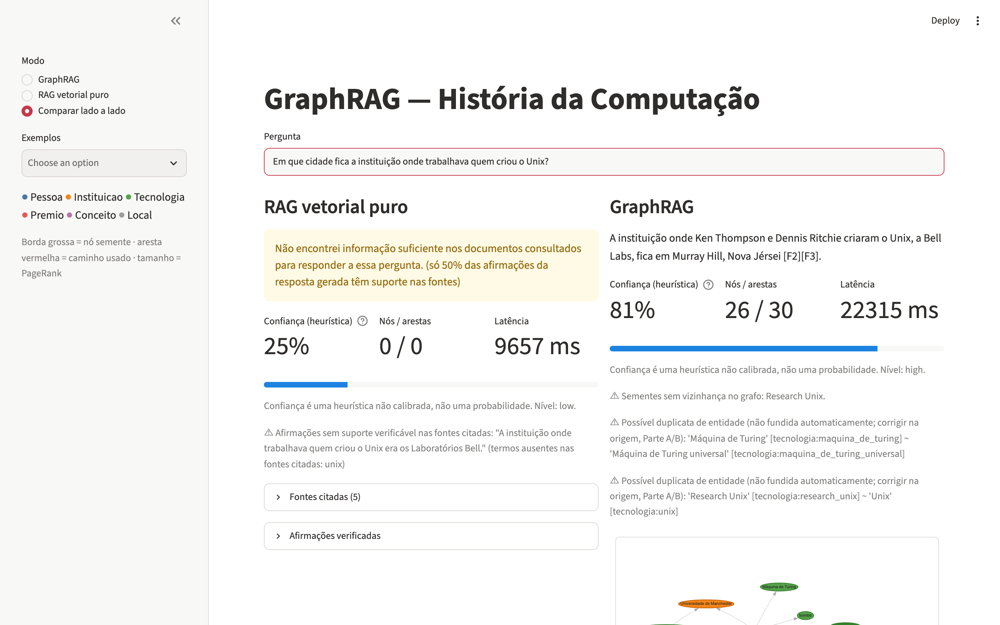
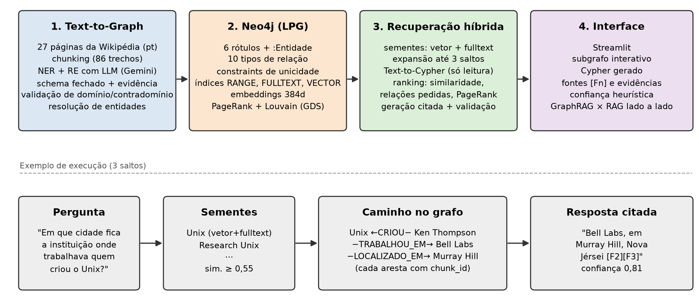
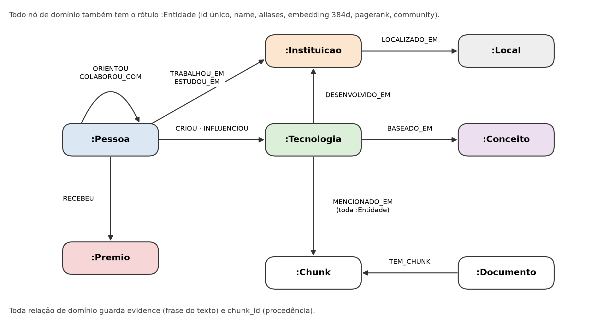

# GraphRAG e KAG para História da Computação

Sistema de perguntas e respostas que usa um **grafo de conhecimento no Neo4j** para responder perguntas
**multi-hop** (que exigem ligar fatos de documentos diferentes) e **reduzir alucinações** de LLMs. Cada
afirmação da resposta é citada até a frase, o trecho e a página da Wikipédia de onde veio.

> Projeto Final da disciplina **Tendências em Ciência da Computação** (Bacharelado em Ciência da Computação,
> Centro Universitário de João Pessoa – UNIPÊ, 2026), Prof. Ricardo Roberto de Lima.



## Resultados

Avaliação com 30 perguntas (5 diretas, 10 de dois saltos, 10 de três saltos e 5 sem resposta no corpus),
usando o **mesmo LLM** (Qwen2.5-7B, local) nos dois sistemas:

| | GraphRAG | RAG vetorial puro |
|---|---|---|
| Perguntas diretas | 5/5 (100%) | 3/5 (60%) |
| 2 saltos | **10/10 (100%)** | 4/10 (40%) |
| 3 saltos | **8/10 (80%)** | 3/10 (30%) |
| **Total (25 respondíveis)** | **23/25 (92%)** | 10/25 (40%) |
| Afirmações sem suporte nas fontes | 0,5% | 2,4% |
| Recusa correta nas 5 perguntas sem resposta | 5/5 | 5/5 |
| Latência média | 45,4 s | 22,8 s |

Métricas automáticas (acerto por palavras-chave). Detalhes em [`parte_c/avaliacao/resultados/`](parte_c/avaliacao/resultados/LEIAME.md)
e no artigo ([`docs/artigo/`](docs/artigo/)).

## Arquitetura



| Pilar | O que faz | Onde está |
|---|---|---|
| **1. Text-to-Graph** | Baixa 27 páginas da Wikipédia (pt), divide em 86 trechos, extrai entidades e relações com LLM (Gemini) num esquema fechado, valida e resolve entidades duplicadas → `grafo.json` (636 entidades, 361 relações) | [`parte_a/`](parte_a/README.md) |
| **2. Neo4j (LPG)** | Esquema com 6 rótulos e 10 tipos de relação, restrições de unicidade, índices RANGE/FULLTEXT/VECTOR, *embeddings* (384d), PageRank e Louvain (GDS), 10 consultas de referência | [`parte_b/`](parte_b/README.md) |
| **3. Recuperação híbrida** | Sementes por vetor + *fulltext*, expansão de até 3 saltos, Text-to-Cypher somente-leitura, resposta citada `[Fn]` com validação determinística, confiança heurística e *baseline* de RAG vetorial | [`parte_c/`](parte_c/README.md) |
| **4. Interface** | Streamlit com o subgrafo usado (caminho em vermelho), Cypher gerado, fontes, confiança e comparação lado a lado | [`parte_d/`](parte_d/README.md) |

Modelo do grafo:



## Estrutura do repositório

```
├── parte_a/   Pilar 1: Text-to-Graph (Lucas)
│   ├── src/                 coleta · chunking · extracao (Gemini) · construir_grafo (validação + resolução)
│   ├── data/                raw/ · chunks/ · cache/ (respostas do LLM) · processed/grafo.json
│   └── avaliacao_extracao.md   avaliação manual (precisão 97,7%, cobertura 75,4%)
├── parte_b/   Pilar 2: Neo4j (João Lucas)
│   ├── neo4j_schema.py · load_graph.py · embeddings.py · gds_algorithms.py · consultas_referencia.py
│   ├── schema.md · schema.cypher
│   └── tests/
├── parte_c/   Pilar 3: recuperação híbrida e geração (Vinícius)
│   ├── retrieval.py · text_to_cypher.py · generation.py · confidence.py · baseline.py · service.py · cli.py
│   ├── avaliacao/           30 perguntas, gabarito e resultados (execução oficial: 20261112-155230)
│   ├── docs/ · tests/
├── parte_d/   Pilar 4: interface Streamlit (Pedro)
│   ├── app.py · graph_view.py · engine_real.py · adaptador_c.py
│   └── tests/
├── contracts.py       Contrato compartilhado entre as partes (rótulos, relações, formatos Pydantic)
├── grafo.json         Grafo final: saída da Parte A, entrada da Parte B
├── requirements.txt   Instala as dependências de todas as partes
└── docs/              Artigo e imagens
```

## Como rodar

### Pré-requisitos

- **Python 3.11+**
- **Docker** (para o Neo4j)
- **[Ollama](https://ollama.com)** (LLM local e gratuito)
- Opcional: chave gratuita do **Gemini** ([aistudio.google.com](https://aistudio.google.com)), só para refazer a extração da Parte A

### 1. Ambiente Python

```bash
python3 -m venv .venv
source .venv/bin/activate
pip install -r requirements.txt
```

### 2. Configuração

```bash
cp .env.example .env
cat .env.c.example >> .env
```

No `.env`, defina `NEO4J_PASSWORD` e `LLM_MODEL=qwen2.5:7b`. Remova as linhas `NEO4J_*` repetidas que vieram do `.env.c.example`.

### 3. Neo4j com Graph Data Science

```bash
docker run -d --name graphrag-neo4j -p 7474:7474 -p 7687:7687 \
  -e NEO4J_AUTH=neo4j/SUA_SENHA \
  -e 'NEO4J_PLUGINS=["graph-data-science"]' \
  -e 'NEO4J_dbms_security_procedures_unrestricted=gds.*' \
  neo4j:5.26-community
```

Use a mesma senha do `.env`. O Neo4j Browser fica em http://localhost:7474.

### 4. LLM local

```bash
ollama pull qwen2.5:7b
```

### 5. Montar o banco (Pilar 2)

A ordem é obrigatória:

```bash
python parte_b/neo4j_schema.py           # constraints e índices
python parte_b/load_graph.py grafo.json  # carga (use --wipe para recarregar do zero)
python parte_b/embeddings.py             # embeddings de entidades e trechos
python parte_b/gds_algorithms.py         # PageRank, Louvain e grau
python parte_b/consultas_referencia.py   # (opcional) roda as 10 consultas de referência
```

### 6. Perguntar (Pilar 3)

```bash
python -m parte_c.cli -q "Em que cidade fica a instituição onde trabalhava quem criou o Unix?"
python -m parte_c.cli --mode both -q "Quem criou o Unix?"      # GraphRAG e baseline
```

### 7. Interface (Pilar 4)

```bash
ENGINE=real streamlit run parte_d/app.py
```

Abra http://localhost:8501. Cada resposta leva de 20 a 50 segundos com o LLM local. Sem Neo4j e Ollama,
`streamlit run parte_d/app.py` abre a interface com um motor simulado.

Perguntas que funcionam bem para demonstração:

- *Em que cidade fica a instituição onde trabalhava quem criou o Unix?* (3 saltos; o RAG puro não responde)
- *Em que instituições trabalhou o criador da linguagem Go?* (2 saltos)
- *Quem criou o Unix?* (direta)
- *Qual a capital da Austrália?* (armadilha: o sistema deve recusar)

### 8. Testes e avaliação

```bash
pytest -q parte_b/tests parte_c/tests parte_d/tests  # 147 testes (integração é pulada se o Neo4j estiver desligado)
python -m parte_c.evaluation                         # avaliação completa (~30 min com LLM local)
```

### Refazer a extração (Pilar 1, opcional)

O `grafo.json` já está pronto. Para reconstruí-lo do zero:

```bash
cp parte_a/.env.example parte_a/.env        # coloque sua GEMINI_API_KEY
python parte_a/src/coleta.py                 # baixa as 27 páginas
python parte_a/src/chunking.py               # 86 trechos
python parte_a/src/extracao.py               # usa o cache em parte_a/data/cache (sem custo) ou chama o Gemini
python parte_a/src/construir_grafo.py        # validação + resolução de entidades
cp parte_a/data/processed/grafo.json grafo.json
```

Depois de mudar o `grafo.json`, repita o passo 5 com `--wipe`.

## Limitações conhecidas

- A extração deixa de fora cerca de 25% dos fatos (cobertura de 75,4%) e tem erros pontuais de direção (ex.: a linguagem B registrada como baseada em C).
- 43,6% das entidades ficaram sem relações (grafo esparso).
- O LLM local de 7B às vezes não combina fatos que recebeu corretamente.
- A avaliação usa 30 perguntas e métricas automáticas; o indicador de confiança não é calibrado.

## Documentação

- [`docs/artigo/`](docs/artigo/): artigo técnico (estilo SBC)
- [`parte_a/README.md`](parte_a/README.md) e [`parte_a/avaliacao_extracao.md`](parte_a/avaliacao_extracao.md): extração e sua avaliação
- [`parte_b/README.md`](parte_b/README.md) e [`parte_b/schema.md`](parte_b/schema.md): modelagem no Neo4j
- [`parte_c/README.md`](parte_c/README.md): motor de respostas (busca, Text-to-Cypher, segurança, confiança)
- [`parte_c/docs/integracao_pessoa_d.md`](parte_c/docs/integracao_pessoa_d.md) e [`parte_d/README.md`](parte_d/README.md): interface

## Equipe

| Parte | Integrante |
|---|---|
| A: Text-to-Graph e integração | Lucas Rodrigues da Silva Coqueiro |
| B: Neo4j | João Lucas Luna Brasileiro |
| C: Recuperação e geração | Vinícius Mendes de Lucena |
| D: Interface | Pedro Henrique Faustino Madruga Navarro |
| [função] | Tiago Leal de Lucena |
| Slides da apresentação | Erickson Cezar Colicchio Junior |

## Créditos

Bibliotecas: Neo4j 5.26 e Graph Data Science 2.13, Neo4j Python Driver, Sentence-Transformers
(`paraphrase-multilingual-MiniLM-L12-v2`), Pydantic, RapidFuzz, Google Gen AI SDK (Gemini), Ollama e
Qwen2.5-7B-Instruct, Streamlit, vis-network e pytest. Textos da Wikipédia em português (CC BY-SA 4.0).
