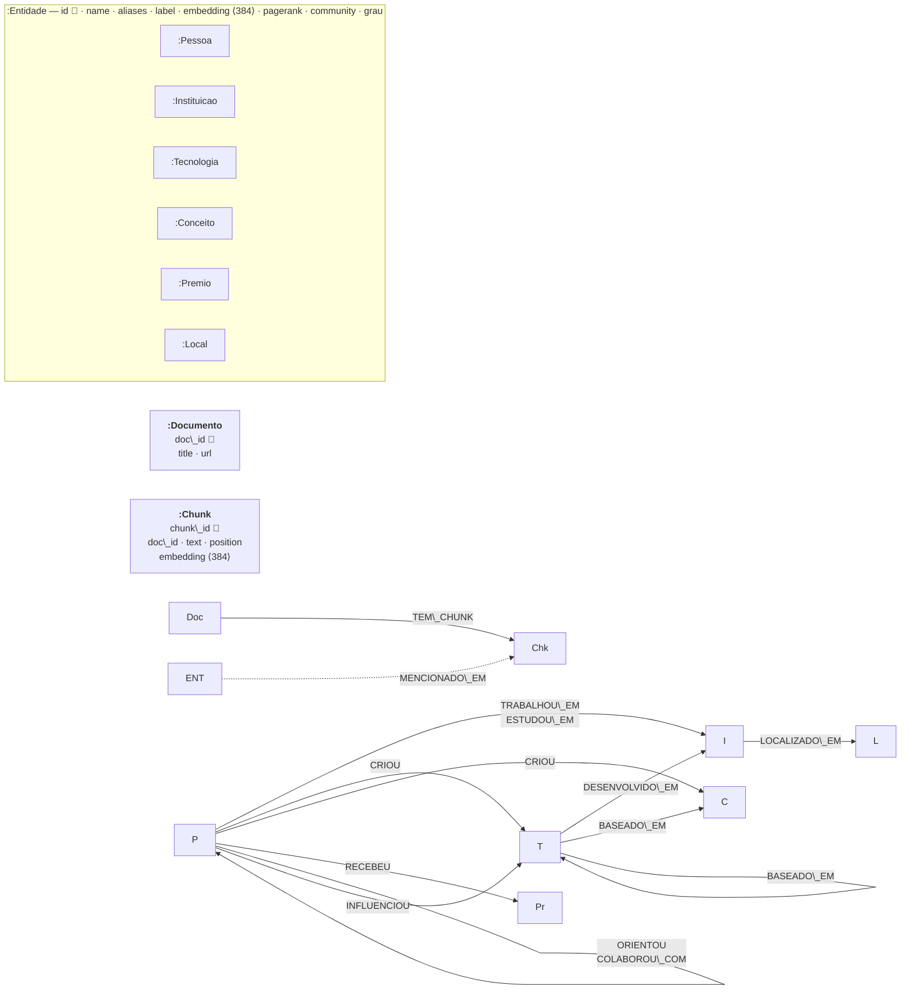

# Diagrama do schema LPG

Renderiza direto no GitHub. Para o artigo: cole o bloco em https://mermaid.live e exporte PNG/SVG.

Notas:

* Toda relação entre entidades tem as propriedades `evidence` (frase do texto) e `chunk\_id` (de onde veio).
* `INFLUENCIOU` vale entre quaisquer entidades exceto `Local`; `CRIOU` também pode partir de `Instituicao` e chegar em `Premio` (ver `RELATION\_SCHEMA` em `contracts.py`).
* 🔑 = constraint de unicidade.

## Índices

|Tipo|Índices|
|-|-|
|Unicidade (RANGE implícito)|`Entidade.id`, `<Label>.id` ×6, `Documento.doc\_id`, `Chunk.chunk\_id`|
|RANGE (B-Tree)|`Entidade.name`, `Entidade.label`, `Entidade.pagerank`, `Entidade.community`, `Chunk(doc\_id, position)`, `Documento.title`, `chunk\_id` em cada tipo de relação|
|FULLTEXT|`Entidade\[name, aliases\_text]`, `Chunk\[text]`, `relações\[evidence]`|
|VECTOR (cosseno, 384)|`Entidade.embedding`, `Chunk.embedding`|

## Números do grafo carregado

|||
|-|-|
|Documentos / Chunks|27 / 86|
|Entidades|637 (197 Instituicao, 161 Pessoa, 152 Tecnologia, 83 Local, 25 Conceito, 19 Premio)|
|Relações do schema|364|
|Entidades sem nenhuma relação|277 (43%)|
|Comunidades Louvain|327 (modularidade 0,862)|
|Top PageRank|Tim Berners-Lee, John von Neumann, Alan Kay, Grace Hopper, Donald Knuth|

