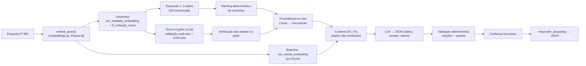

# Parte C — Motor GraphRAG/KAG (recuperação híbrida, resposta citada, confiança e baseline)

A Parte C recebe uma pergunta em português, busca evidências no Neo4j da Parte B, gera (opcionalmente)
uma consulta Cypher com LLM, monta um contexto com fontes numeradas, produz uma resposta **citada** e
um indicador de confiança **explicável**. Também implementa o **baseline RAG vetorial puro** usado na
comparação experimental. A interface (Streamlit) é da Pessoa D — ver
[integracao_pessoa_d.md](docs/integracao_pessoa_d.md). Texto técnico para o artigo: [parte_c_artigo.md](docs/parte_c_artigo.md).

> **Nada da Parte C escreve no banco.** Todas as sessões Neo4j são abertas em modo `READ`
> (`execute_read`) com timeout. A Parte B (`load_graph.py`, `neo4j_schema.py`, `embeddings.py`,
> `gds_algorithms.py`) **não** é executada pela Parte C — apenas reaproveitada.

## 1. Arquitetura



| Arquivo | O que faz |
|---|---|
| `parte_c/config.py` | Lê `.env`: provedor de LLM, limites (top_k, hops, timeout, teto de contexto). |
| `parte_c/schemas.py` | Contratos Pydantic: `QAResponse`, `Source`, `Subgraph`, `Confidence`, enums de status. |
| `parte_c/graph_store.py` | **Todas** as leituras no Neo4j (sessão READ + timeout). Executa a Q8 original em `q8_reference`. |
| `parte_c/retrieval.py` | C1: pergunta livre → sementes → caminhos → ranking → fontes com procedência. |
| `parte_c/text_to_cypher.py` | C2: geração de Cypher com LLM, validação em 5 camadas, 1 correção, fallback. |
| `parte_c/llm_adapter.py` | Provedores: `ollama` (principal, local, `qwen2.5:7b`), `anthropic` (opcional), `FakeLLM` (testes). |
| `parte_c/generation.py` | C3: contexto [Fn], prompt grounded, validação de citações e de suporte, abstenção. |
| `parte_c/confidence.py` | C4: confiança heurística (fatores, pesos, penalidades, tetos). |
| `parte_c/baseline.py` | C5: RAG vetorial puro sobre `:Chunk`. |
| `parte_c/service.py` | C6: `responder_pergunta(pergunta, modo)` — o contrato da Pessoa D. |
| `parte_c/cli.py` | Perguntas livres no terminal. |
| `parte_c/evaluation.py` | C7: experimento GraphRAG × baseline, exporta CSV/JSON/MD. |
| `parte_c/avaliacao/perguntas.jsonl` | 30 perguntas com gabarito verificado no `grafo.json` (`construir_gabarito.py`). |

### Por que existe uma "Q8 estruturada" além da Q8?
A Q8 (`consultas_referencia.py`) devolve **strings** (`"A -TIPO-> B"`) e tem saltos fixos `1..2`.
A UI precisa de nós/arestas com IDs de domínio e cada aresta precisa virar uma fonte citável.
`EXPANSION_CYPHER` (em `graph_store.py`) segue o **mesmo método** da Q8 — índice
`vec_entidade_embedding` → expansão pelas 10 relações (`REL` da Pessoa B) → ordenação com PageRank —
mas devolve estrutura, aceita 1..3 saltos e descarta caminhos com nós repetidos. A Q8 original **não
foi alterada** e continua sendo executada literalmente (`Neo4jGateway.q8_reference`); um teste de
integração confere que as sementes da Parte C coincidem com as da Q8.

## 2. Instalação (Windows / PowerShell)

Na raiz do projeto (pasta que tem `README.md` e `contracts.py`):

```powershell
# (opcional, recomendado) ambiente virtual
python -m venv .venv
.\.venv\Scripts\Activate.ps1

pip install -r parte_c/requirements.txt
```

`parte_c/requirements.txt` já inclui `parte_b/requirements.txt` e adiciona só `httpx` (para falar com o
Ollama). Testado aqui com **Python 3.14.7**, `neo4j` 6.4.1, `sentence-transformers` 6.1.0, Ollama
0.40.16. Se alguma biblioteca falhar no 3.14, crie o venv com 3.12/3.13 (`py -3.12 -m venv .venv`)
sem apagar o ambiente atual.

### Configurar o LLM — Ollama (principal, local e gratuito)
O provedor principal do projeto é o **Ollama** com o modelo **`qwen2.5:7b`**. Ele é o padrão do código:
se `LLM_PROVIDER` não estiver no `.env`, a Parte C já tenta usar o Ollama.

1. Instale o Ollama (ollama.com/download → Windows) e baixe o modelo:
   ```powershell
   ollama pull qwen2.5:7b
   ```
2. (Recomendado) deixe explícito no `.env` — modelo em [`.env.c.example`](../.env.c.example):
   ```
   LLM_PROVIDER=ollama
   LLM_MODEL=qwen2.5:7b
   ```
3. Deixe o Ollama aberto (ícone da lhama perto do relógio) enquanto usa o sistema.

Se o Ollama estiver fechado, o sistema não trava: responde em modo **`retrieval_only`** (mostra as
evidências, sem texto gerado) e avisa "Ollama inacessível". Para desligar o LLM de propósito, use
`LLM_PROVIDER=none` ou a opção `--no-llm` da CLI.

Requisitos observados: o `qwen2.5:7b` ocupa ~4,7 GB; com a janela de 12.288 tokens rodou ~76% na GPU
(RTX 4050, 6 GB) e ~24% na CPU, levando ~10–60 s por pergunta.

**Alternativa opcional (paga):** Claude, da Anthropic — `pip install anthropic`, `LLM_PROVIDER=anthropic`
e `ANTHROPIC_API_KEY=...` no `.env` (modelo padrão `claude-opus-5-5`). Cada pergunta faz até 3 chamadas
à API. Esse caminho está implementado com o SDK oficial, mas **não foi testado** neste projeto. A chave
fica **só** no `.env` (ignorado pelo git); nenhum log/trace imprime chaves ou senhas.

## 3. Como usar

Ligue a instância Neo4j (Neo4j Desktop → *Start*, ou `iniciar_neo4j.ps1`). Depois:

```powershell
# pergunta livre (GraphRAG, estratégia auto)
python -m parte_c.cli -q "Quem criou o Unix?"

# mostrar consultas Cypher executadas, parâmetros e tempos
python -m parte_c.cli -q "Em que cidade fica a instituição onde trabalhava quem criou o Unix?" --hops 3 --show-trace

# baseline, ou os dois lado a lado
python -m parte_c.cli -q "Quem criou o Unix?" --mode baseline
python -m parte_c.cli -q "Quem criou o Unix?" --mode both

# forçar estratégia: vector (só vetor+grafo, como a Q8) | text2cypher | auto
python -m parte_c.cli -q "Quem criou o Unix?" --strategy text2cypher

# sem gastar API (mesmo com chave configurada) / JSON completo do contrato
python -m parte_c.cli -q "Quem criou o Unix?" --no-llm
python -m parte_c.cli -q "Quem criou o Unix?" --json > resposta.json
```

**Como saber que funcionou:** a saída mostra `status:` (`answered`, `retrieval_only` ou
`insufficient_evidence`), a confiança, as sementes, as fontes `[F1]..` com documento, chunk e o trecho
literal, e um resumo do subgrafo. A primeira pergunta demora ~40 s porque carrega o modelo de embeddings.

Em Python (o que a Pessoa D usa):

```python
from parte_c import responder_pergunta
r = responder_pergunta("Quem criou o Unix?", modo="graphrag")
print(r["status"], r["answer"], r["confidence"]["level"])
```

### Estratégias do modo GraphRAG
| `estrategia` | Comportamento |
|---|---|
| `auto` (padrão) | Sempre faz vetor+grafo. Se houver LLM, também tenta Text-to-Cypher; se a consulta gerada for validada e executada, suas arestas (verificadas) entram **na frente** do contexto. |
| `vector` | Só vetor+grafo (Q8 estruturada). Não chama LLM para Cypher. |
| `text2cypher` | Usa só a consulta gerada; em qualquer falha cai para `vector` (status `fallback`/`rejected`). |

## 4. Testes

```powershell
python -m pytest -q parte_b/tests parte_c/tests            # tudo (Parte B + Parte C)
python -m pytest -q parte_c/tests                          # só a Parte C
python -m pytest -q parte_c/tests/test_parte_c_integration.py -rs  # integração real (pulada se o Neo4j estiver desligado)
$env:RUN_LLM_TESTS="1"; python -m pytest -q parte_c/tests/test_parte_c_integration.py   # + 1 chamada real (paga) ao LLM
```

Use sempre `python -m pytest` (e não só `pytest`): no Windows, a pasta onde o pip instala o
executável `pytest.exe` muitas vezes não está no PATH, o que gera o erro
"O termo 'pytest' não é reconhecido como nome de cmdlet".

| Arquivo | Cobre |
|---|---|
| `test_parte_c_retrieval.py` | termos fulltext, ranking determinístico, 2 e 3 saltos, sementes sem vizinhança, duplicatas, sessões READ |
| `test_parte_c_security.py` | 26 consultas maliciosas rejeitadas, few-shots e Q1–Q10 válidas, LIMIT imposto, literal da pergunta, EXPLAIN, correção única, timeout, vazio, sem LLM |
| `test_parte_c_generation.py` | teto de contexto, prompt injection, citações inválidas, alucinação → abstenção, sem LLM |
| `test_parte_c_baseline.py` | baseline só com Chunk; confiança forte/fraca/vazia, tetos, determinismo |
| `test_parte_c_contract.py` | JSON completo do contrato, subgrafo = fontes usadas, erros sem stacktrace, estratégias, smoke da CLI |
| `test_parte_c_evaluation.py` | gabarito verificável no `grafo.json`, métricas, exportação de arquivos |
| `test_parte_c_integration.py` | Neo4j real, só leitura; confere que as contagens de nós/relações não mudam |

Os testes unitários usam `parte_c/tests/fakes_parte_c.py`: um **gateway falso** que responde com os dados reais
do `grafo.json` em memória e um **embedding falso** determinístico (não é o modelo real; serve para
os testes serem reprodutíveis e rodarem sem banco).

## 5. Avaliação GraphRAG × baseline

```powershell
python parte_c/avaliacao/construir_gabarito.py           # (re)gera parte_c/avaliacao/perguntas.jsonl validando no grafo.json
python -m parte_c.evaluation --limite 3 --no-llm  # ensaio rápido, sem custo
python -m parte_c.evaluation                      # experimento completo (30 perguntas × 2 modos)
```

Resultados em `parte_c/avaliacao/resultados/<data-hora>/` (`metricas.csv`, `resumo.md`, `respostas.jsonl`,
`anotacao_humana.csv`). As métricas automáticas são **aproximadas**; a planilha `anotacao_humana.csv`
é para a rubrica humana (correção 0–2, suporte 0–2, alucinação, multi-hop). A execução oficial é
`20261111-222956` (ver [`parte_c/avaliacao/resultados/LEIAME.md`](avaliacao/resultados/LEIAME.md));
seus números estão na seção 9 do artigo, ainda **pendentes de anotação humana**.

## 6. Decisões e fórmulas (resumo; detalhes no artigo)

**Ranking de caminhos (C1)** — versão 2 (após o 1º experimento)
* Sementes: índice vetorial + fulltext de nomes próprios (peso 4) **e** de termos compostos em
  minúsculas da pergunta (ex.: "teoria da informação", "arquitetura de von Neumann").
* Expansão de até **3 saltos** (padrão), até 60 caminhos por semente.
* **Pistas de relação**: palavras da pergunta indicam os tipos de relação pedidos ("criou" → CRIOU,
  "trabalhava" → TRABALHOU_EM, "fica/cidade" → LOCALIZADO_EM…; tabela `RELATION_CUES` em
  `retrieval.py`). Sem pistas: `score = (0,55·σ + 0,35·sim + 0,10·PR) · 0,95^(saltos−1)`.
  Com pistas: `score = (0,40·σ + 0,25·sim + 0,25·R + 0,10·PR) · 0,95^(saltos−1)`, onde
  `R = 0,5·cobertura das relações pedidas + 0,5·fração de arestas do caminho com tipo pedido`.
* Arestas de tipo **não** pedido ocupam no máximo 1/3 do orçamento (`GRAPHRAG_MAX_EDGES`).
* Similaridade = relevância semântica (escala do Neo4j, (1+cos)/2), **não** verdade. PageRank =
  centralidade, peso pequeno, **não** factualidade. Caminhos inteiros entram no contexto,
  preservando as cadeias multi-hop.
* Efeito medido no banco real (25 perguntas respondíveis do gabarito): arestas-ouro presentes no
  contexto passaram de parcial (T03/T04/T07 sem os elos necessários) para **60 de 60**.

**Validação das respostas (C3)** — versão 2: todo nome próprio ou número de uma afirmação precisa
aparecer nas fontes que ela cita (tolera 1 variação de nome com ≥60% de palavras em comum); a
resposta só é entregue se **≥60%** das afirmações tiverem suporte, senão vira abstenção. Vale igual
para GraphRAG e baseline. Motivo: no 1º experimento o baseline teve respostas aceitas com afirmações
apoiadas em conhecimento externo (cidade ausente dos trechos citados).

**Confiança (C4)** — `heuristico_nao_calibrado`. Fatores: cobertura 0,35; procedência 0,25;
relevância 0,20; consistência 0,20 (renormalizados se algum não se aplica). Penalidades por citação
inexistente, afirmação sem suporte, fallback do Text-to-Cypher, duplicata de entidade e contradição.
Tetos: abstenção ≤ 0,25; sem LLM ≤ 0,60. Níveis: alta ≥ 0,75 > média ≥ 0,50 > baixa.
Os limiares de relevância (0,70–0,90) **não foram calibrados**: calibrar com a avaliação.

**Segurança do Text-to-Cypher (C2)** — 5 camadas: (1) prompt com o esquema real e exemplos
revisados; (2) validador por allowlist (palavras de escrita, procedimentos, funções, labels, tipos,
propriedades, limite de saltos, literais vindos da pergunta, LIMIT); (3) `EXPLAIN` no servidor exige
`query_type == 'r'` e nenhum operador de escrita; (4) execução em sessão READ com timeout e teto de
linhas (e usuário só-leitura, se o servidor suportar papéis); (5) cada aresta citada pela consulta é
**conferida** no grafo antes de virar fonte. No máximo uma correção automática; depois, fallback.

**Reparos determinísticos (para modelos locais pequenos)** — feitos pelo código, sem LLM, e sempre
seguidos de toda a validação + EXPLAIN; ficam registrados em `generated_cypher.repairs`:
1. *Caminho não declarado*: se a consulta usa `relationships(p)`/`nodes(p)`/`length(p)` sem
   `MATCH p = ...`, o código acrescenta `p = ` no primeiro MATCH com relacionamento (ou `caminho = `,
   se `p` já for um nó).
2. *Direção invertida*: se a consulta válida volta vazia, ela é repetida com as setas sem direção
   (os tipos de relação continuam restringindo; as evidências trazem a direção real). Se ainda vier
   vazia, a única correção do LLM é usada com a dica de conferir as direções do esquema.
3. Nomes do próprio esquema escritos como texto (ex.: `{label: 'Conceito'}`) não são tratados como
   "valor da pergunta interpolado"; nomes de pessoas/tecnologias continuam proibidos como literal.

## 7. O que foi verificado neste ambiente (honestidade)

| Item | Situação |
|---|---|
| Testes unitários da Parte C (sem banco, sem LLM) | **Passaram** (`pytest -q parte_c/tests`: 110 passed). |
| Testes da Parte B (`test_parte_b.py`) | **Continuam passando**. |
| Modelo de embeddings real (`embed_query`) | **Carregou** no Python 3.14 (384 dim, normalizado). |
| Integração com o Neo4j real | **Passou** (2026-11-11): `python -m pytest -q parte_b/tests parte_c/tests -rs` → 127 passed, 1 skipped (o pulado é o teste pago de LLM). Inclui sementes iguais às da Q8, multi-hop Unix → Bell Labs → Murray Hill, EXPLAIN read-only no servidor e contagem de nós/relações inalterada. |
| Escala real de similaridade (observação, não calibração) | Entidades relevantes: ~0,73–0,81; perguntas fora do domínio: ~0,65–0,71. Chunks relevantes: ~0,75–0,89; fora do domínio: ~0,56–0,62. Em "Que linguagem John McCarthy criou?" o índice vetorial **não** trouxe McCarthy no top-3 (0,73 para entidades não relacionadas); a semente fulltext de nomes próprios é o que o recupera. |
| Chamada real ao LLM (Ollama `qwen2.5:7b`, RTX 4050) | **Funcionou** após corrigir a janela de contexto: "Quem criou o Unix?" → `answered`, "O Unix foi criado por Dennis Ritchie e Kenneth Thompson [F2][F20]", confiança alta, ~54 s. Antes da correção o Ollama usava 4096 tokens e cortava o início do prompt (regras + pergunta), gerando uma resposta sem relação com a pergunta. |
| Text-to-Cypher real com `qwen2.5:7b` (10 perguntas do gabarito) | Antes dos reparos: só 2 de 6 executadas (erros de sintaxe e direção). Depois dos reparos determinísticos (seção 6): **6 de 10 executadas**, todas recuperando arestas do gabarito (D01, D02, M01, M06, T01, T02); U01 (fora do domínio) recusada corretamente; M02, T08 (cadeia montada errada) e D05 (id candidato errado) caíram no fallback seguro. Amostra pequena, só para diagnóstico — não é resultado do artigo. |
| Chamada real ao Claude (alternativa opcional) | **Não executada** (sem chave). Caminho implementado com o SDK oficial. |
| Experimento comparativo | **Executado** (2 versões). Oficial: `parte_c/avaliacao/resultados/20261112-155230` (grafo final) — acerto por palavras-chave GraphRAG 23/25 × baseline 10/25; abstenção correta 5/5 nos dois; latência 45,4 s × 22,8 s (Apple M5). Anterior: `20261111-222956` (22/25 × 10/25). Números no artigo (seção 9), marcados como automáticos. **Pendente:** anotação humana e validação do gabarito. Ver `parte_c/avaliacao/resultados/LEIAME.md`. |

## 8. Problemas de dados encontrados (para o grupo corrigir na origem — Partes A/B)

A Parte C **não altera o banco**; apenas avisa (campo `warnings`) e documenta:
* **Entidades duplicadas**: `pessoa:ken_thompson` × `pessoa:kenneth_thompson`; `Bell Labs`,
  `Bell Telephone Labs`, `AT&T Bell Labs`; `local:nova_jersei` × `local:nova_jersey`. O sistema
  avisa "Possível duplicata de entidade (não fundida automaticamente)" e penaliza a confiança.
* **Direção invertida**: `tecnologia:b -BASEADO_EM-> tecnologia:c_linguagem_de_programacao`, mas a
  evidência diz que B é *antecessora* de C (o correto seria C BASEADO_EM B).
* 43% das entidades não têm relação nenhuma (dado da Parte B) — perguntas sobre elas tendem à abstenção.

## 9. Problemas comuns

| Sintoma | Causa provável | Correção |
|---|---|---|
| `status: error` + "Banco Neo4j indisponível" | instância desligada ou `.env` errado | Neo4j Desktop → Start; confira `NEO4J_URI`/`NEO4J_PASSWORD` no `.env`. Teste: `python parte_b/consultas_referencia.py Q8`. |
| `AuthError` / `Unauthorized` | senha do `.env` diferente da do banco | corrija `NEO4J_PASSWORD` no `.env`. |
| `status: retrieval_only` e aviso "Ollama inacessível" | Ollama fechado | abra o Ollama (menu Iniciar) e confira com `ollama list`. |
| aviso "Ollama devolveu HTTP 404" | modelo do `LLM_MODEL` não foi baixado | `ollama pull qwen2.5:7b` ou corrija o nome conforme `ollama list`. |
| aviso "pedido maior que a janela do Ollama" | contexto grande demais para `OLLAMA_NUM_CTX` | aumente `OLLAMA_NUM_CTX` ou reduza `MAX_CONTEXT_CHARS` no `.env`. |
| Primeira pergunta lenta (~40 s) | carregamento do modelo de embeddings em CPU | normal; as seguintes são rápidas no mesmo processo. |
| Avisos `HF_TOKEN` / `FutureWarning` | mensagens do Hugging Face/sentence-transformers | podem ser ignorados. |
| Text-to-Cypher sempre `fallback`/`rejected` | LLM gerou consulta fora da política | veja `generated_cypher.error`; é o comportamento seguro esperado. |
| `insufficient_evidence` em pergunta que deveria ter resposta | fato ausente no grafo ou sementes ruins | rode com `--show-trace`, veja as sementes; tente `--hops 3`. |

## 10. Créditos e uso de IA
Bibliotecas: Neo4j Python Driver, Neo4j (índices vetoriais/fulltext), Neo4j GDS (via propriedades
gravadas pela Parte B), Sentence-Transformers (`paraphrase-multilingual-MiniLM-L12-v2`), Pydantic,
python-dotenv, pytest, Ollama + modelo Qwen2.5-7B-Instruct (Alibaba, via `qwen2.5:7b`), httpx;
opcionalmente Anthropic Python SDK.
O SDK `neo4j-graphrag` **não** foi usado: as classes `Text2CypherRetriever`/`VectorCypherRetriever`
não reaproveitariam a Q8, o `embed_query` da Parte B e a validação read-only exigida sem adaptação
equivalente ao código escrito aqui.
**Uso de IA:** o código, os testes e a documentação da Parte C foram desenvolvidos com auxílio do
Claude Code (Anthropic), sob supervisão do aluno responsável, que deve revisar e compreender o
material antes da entrega e da defesa.
